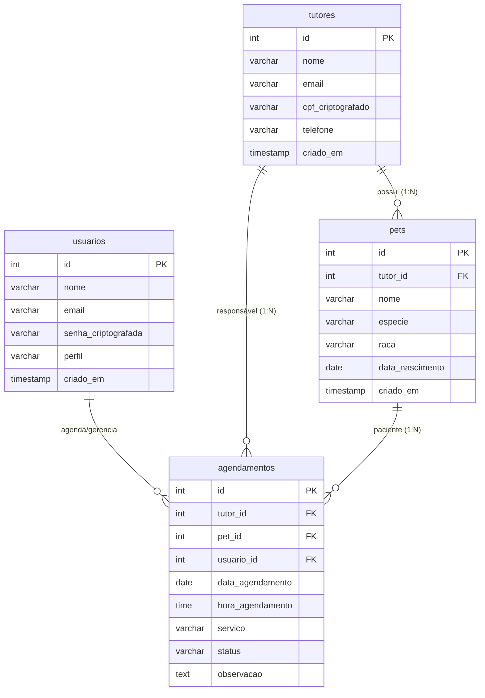

# Sistema de Gestão de Clínica Veterinária

**Tecnologias:** PHP 8.5, PostgreSQL, PDO (Prepared Statments)\
**Arquitetura:** MVC Artesanal, AutoLoad PSR-4 via composer

## Apresentação do Projeto e Visão Geral

Este documento apresenta a evolução integral do **Sistema de Gestão de Clínica Veterinária** com requisitos funcionais e diagrama de entidade relacionamento.

### Identificação do Projeto

**Nome do sistema:** CliVet - Gestão de Clínica Veterinária \
**Público-alvo:** Gestores da clínica (veterinários, recepcionistas).\
**Problema:** Eliminação dos controles manuais, duplicidade e perda de informações, risco de vazamento de dados (LGPD).

---

### Requisitos Funcionais

| ID | Requisito | Descrição |
|-|-|-|
| **RF-01** | Autenticação de usuários com tempo de expiração | Permite a autenticação de usuários no sistema com email e senha e validar o acesso exibindo um alerta em caso de falha. Após 15 minutos de inatividade o usuário deve ser deslogado. |
| **RF-02** | Logout | O sistema deve permitir que o usuário realize logout |
| **RF-03** | Listagem de tutores | O sistema deve permitir que o usuário realize uma busca inserindo um termo e o sistema exibirá os termos correspondentes. |
| **RF-04** | Edição de tutores | O sistema deve permitir que os dados de um tutor já cadastrado sejam editados. |
| **RF-05** | Listagem de agendamentos | O sistema deve listar os agendamentos já cadastrados por dia de agendamento, trazendo dados do tutor e do pet. |
| **RF-06** | Editar um agendamento | O sistema deve permitir que um agendamento já cadastrado seja editado. |
| **RF-07** | Cadastrar um tutor | O sistema deve permitir o cadastro de um novo tutor, sendo que seu CPF deve ser criptografado. |
| **RF-08** | Cadastrar um pet | O sistema deve permitir o cadastro de um novo pet, associado a um tutor. |
| **RF-09** | Listagem de pets | O sistema deve exibir uma lista com os pets cadastrados e suas informações. |

### Diagrama de Entidades Relacionais (DER)

### Banco de Dados - Script de Criação e População

### Construção da Aplicação (`sistema/`)

